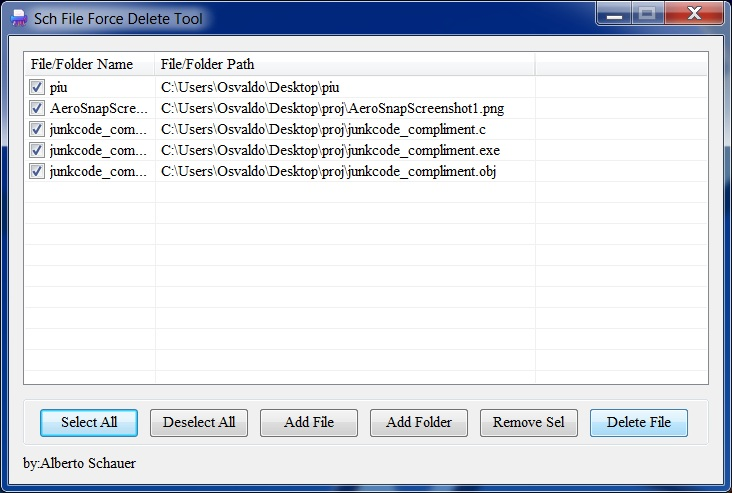
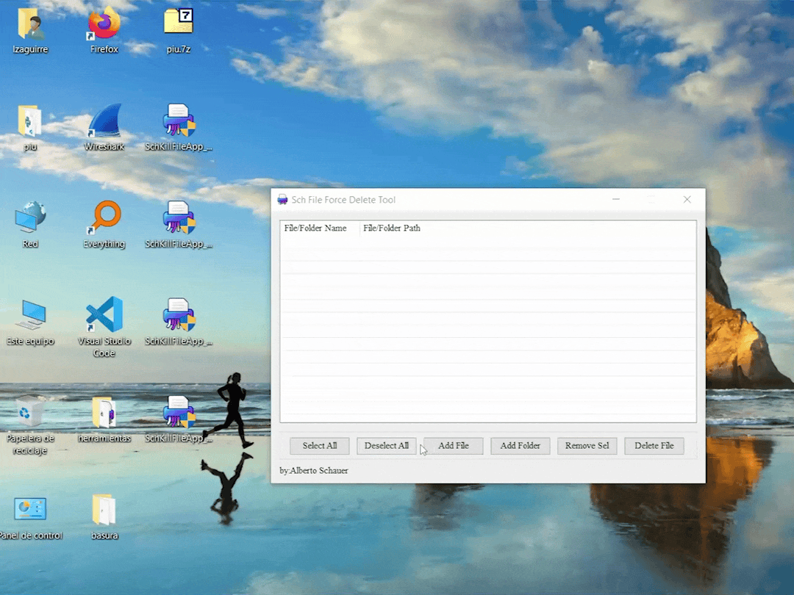

# SchKillFile – Force Delete Locked Files and Folders (Kernel Mode)

**SchKillFile** is a Windows utility designed to forcibly delete files and folders that are otherwise locked or in use by other running processes. It achieves this by utilizing its own custom kernel-mode driver, which allows it to bypass standard user-mode restrictions, ensuring deletion of resources that normally prove undeletable. This tool is intended for experienced users, developers, and system administrators who understand the implications of low-level system operations.

---

> **⚠️ IMPORTANT WARNING:** Because this tool interacts directly with Windows kernel-mode APIs and drivers, using it improperly carries a risk of system instability or data loss. Only run this if you are completely certain about what you are doing.
>
> **You must run this program with Administrator privileges** because it needs to install and load the necessary kernel-mode driver.

---

## Features

*   Bypasses typical file locks by executing deletion commands within the Windows kernel itself.
*   It automatically finds and closes system-wide handles that are pointing to your target files.
*   Terminates processes holding exclusive locks on files, though it includes built-in safety measures to prevent crashes (BSODs) when dealing with critical system processes.
*   Uses an advanced, converging iterative deletion algorithm to successfully remove complex directory structures.
*   If immediate kernel-mode deletion fails, the file can be queued up for deletion during the next system restart ("Delete on Reboot").
*   Supports multiple architectures: x86, x64, ARM32, and ARM64.
*   Features a simple GUI built using the MFC framework.
*   Supports dragging and dropping files or folders into the application window.
*   Allows for multi-selection and batch deletion operations.
*   The kernel-mode driver is deployed and removed dynamically while the program is running.

---

### Where You Can Use It (Possible Use Cases)

*   When you need to remove stubborn malware files that standard methods can't touch.
*   To clean up temporary files held open by processes that have frozen or crashed.
*   Deleting locked folders, especially from external drives or after an application uninstall failed midway through.
*   Bypassing file locks for forensic analysis, debugging, or reverse engineering tasks.
*   Getting rid of orphaned files left over from interrupted installations or outdated system components.
*   Performing automated cleanup in development environments where build artifacts are stubbornly held open.

---

## Screenshots

*Tested successfully on Windows 7 SP1 and Windows 10 22H2*
> 
> 

---

## Getting Started

### Prerequisites

*   Windows 7 or newer (works with both 32-bit and 64-bit versions).
*   Administrator rights are mandatory.
*   Visual Studio is required if you plan on compiling it yourself.
*   (For development/testing): Driver signing enforcement should be temporarily disabled.

### How to Run It

1.  Right-click and run `SchKillFile.exe` as Administrator.
2.  Use the **Add File** or **Add Folder** buttons provided to queue up the entries you want to delete.
3.  (Optional Shortcut) You can drag and drop files/folders directly onto the window.
4.  Select all items using **Select All**, or choose individual ones manually.
5.  Click **Delete File** to initiate the forced deletion of everything selected.

---

## Technical Deep Dive: How It Works

### Application Layer (The Control Center)

This application acts as the main interface, managing the entire life cycle of the kernel driver. When it starts up, it first checks the host machine's processor architecture and pulls the correct corresponding driver binary (`.sys`) from its internal resources. It then installs and launches this driver as a system service. All communication between the GUI and the low-level driver is handled using specialized I/O Control (IOCTL) codes sent via `DeviceIoControl`.

### Kernel-Mode Driver (The Heavy Lifter)

This dedicated driver component does the tough work using several sophisticated techniques:

1.  **Handle Analysis**: It uses the `ZwQuerySystemInformation` function to grab a complete snapshot of every active handle across the entire system. It then filters this massive list specifically looking for handles that reference your target file paths.
2.  **Forced Unlocking**: When it finds a lock, the driver attaches itself to the owning process's memory space, forcibly closes the handle, and terminates the associated process—unless the process is recognized as one of the critical system services (to avoid crashing the OS).
3.  **Cache & Image Flushing**: Before deletion can occur, the driver first clears out the system cache and flushes image sections (`CcPurgeCacheSection` and `MmFlushImageSection`) to make sure the file isn't currently mapped in memory somewhere else.
4.  **IRP-Based Deletion**: The actual removal is performed by manually constructing and sending I/O Request Packets (IRPs) directly down to the file system's device stack, setting the `FileDispositionInformation` flag to true.
5.  **Iterative Folder Deletion**: For directories, it first runs a BFS scan to map every single sub-item, and then executes a specialized deletion loop that removes children before it attempts to remove their parent folder.

---

## Security & Caveats (Limitations)

*   **Danger Zone:** Misusing this tool could delete system-critical files.
*   **Signing Status:** By default, the driver uses **self-signed certificates**. For official production use, WHQL signing is required.
*   **Memory Mapping Issues:** Files or folders that have deeply integrated memory-mapped sections still held by other kernel or filter drivers might resist deletion until those mappings are removed. In these cases, relying on the "Delete on Reboot" fallback is necessary.
*   **Filter Interference:** Be aware that file system filter drivers (like antivirus scanners or EFS/backup filters) can intercept or block the delete requests.
*   **Path Length Limits:** Extremely long paths (> 260 characters) or names exceeding the fixed 512-WCHAR buffers within the driver might cause failures or result in truncated filenames.
*   **Volume Scope:** The current implementation is tailored for local NTFS/FAT32 volumes and may not behave identically on network storage or specialized virtual volumes. **Network paths (UNC)** are not supported; it only handles native local namespace identifiers (`\Device\…`/`\??\…`).
*   **IRQL Restriction:** All deletion IRPs run at **PASSIVE_LEVEL**; any operation attempting to initiate at a higher Interrupt Request Level (IRQL) will be rejected by the driver.

---

## License

This project is released under the MIT License. For full details, please see the [LICENSE](LICENSE) file.